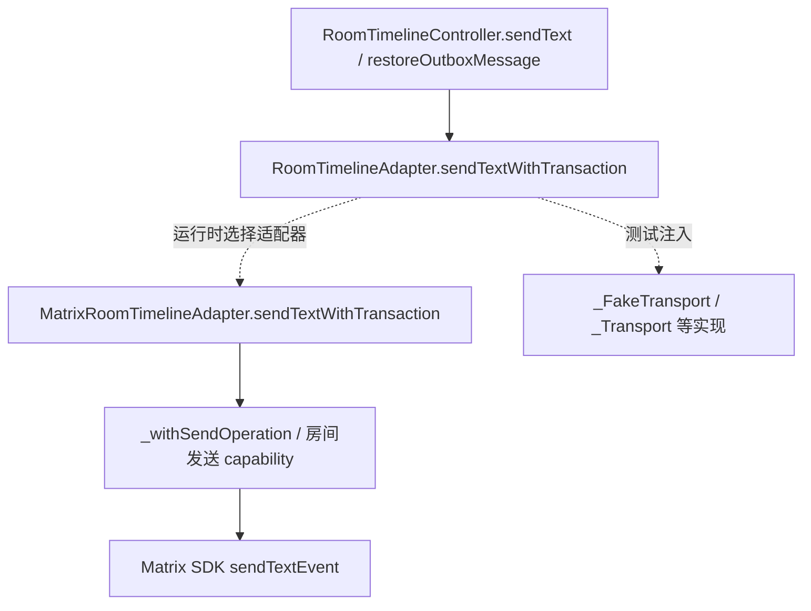

# CodeGraph 调用关系补充

状态：Reference。2026-10-22；补充[项目梳理报告](2026-10-22-project-map.md)，不把先前静态阅读重新标记为图分析。

## 索引身份与范围

本轮用户明确要求完成索引，已在 `D:/pythonProject/outsource/StarChat` 执行 `codegraph init --yes`，退出 0。此前没有 `.codegraph/` 而跳过索引的记录仍保留为第一轮事实。

| 项目 | 实测值 |
| --- | --- |
| 源码 | `main`，`5c83a08a09b985146bc507a1608cb2153d361e48`，含原有未提交的发布文档/页面 |
| 引擎/提取版本 | CodeGraph 1.6.0 / extraction 25，node-sqlite |
| 索引时间 | 2026-10-22 22:28:46.793 UTC+08:00 |
| 完成状态 | `complete`，`pendingRefs=0`，新增/修改/删除 pendingChanges 均为 0，无 worktreeMismatch |
| 规模 | 2,602 files，53,036 nodes，218,898 edges，数据库 230,715,392 bytes |
| 语言 | C、Dart、JavaScript、Kotlin、Objective-C、properties、Python、Swift、XML、YAML |

证据：[索引状态](../verification/artifacts/2026-10-22/project-maintenance/followup/codegraph-status.json)、[初始化日志](../verification/artifacts/2026-10-22/project-maintenance/followup/codegraph-init.log)。它是 **main 的图**，不代表候选 `codex/interactive-cache-startup-20261016` 的图。

索引配置排除 `docs/verification/`、`docs/archive/`、`migration-artifacts/`、`data/`、`.worktrees/`、`.env`、构建/Gradle 目录和个推 SDK 分发包；纳入受跟踪 Matrix/video_compress fork 的当前库源码。变更前的忽略配置已保存为 [codegraph-config-before.json](../verification/artifacts/2026-10-22/project-maintenance/followup/codegraph-config-before.json)。`.codegraph/` 与配置仍受 Git 忽略，不提交数据库；没有升级 CodeGraph 或修改产品源码。

## 查询与确认结果

以下均来自实际 `codegraph_explore(projectPath=...)` 返回，原始结果包含逐行源码、关系和影响范围，按表链接保存。带路径的查询用于降低跨语言同名符号混淆。

| 入口/风险 | 实际查询 | 图结果与维护用途 |
| --- | --- | --- |
| API 装配与钱包共享 runtime | `services/business-api/app/main.py create_default_app create_app create_manual_wallet_runtime Settings` | 明确路径：`create_default_app:293 → create_app:46 → create_manual_wallet_runtime:52`；runtime 同时被 API、Worker 装配使用。[原始结果](../verification/artifacts/2026-10-22/project-maintenance/followup/codegraph-entry.md) |
| 转账事务与 Outbox | `ChatTransferService.create LedgerService.post LedgerService._post OutboxPublisher.enqueue` | 明确路径：`transfer/service.py:create:26 → ledger/service.py:post:67 → _post:71 → core/outbox.py:enqueue:51`。应保持同一事务中的账本、审计、Outbox 原子性。[原始结果](../verification/artifacts/2026-10-22/project-maintenance/followup/codegraph-ledger.md) |
| 客户端接口分派 | `MatrixE2eeClient MatrixSdkE2eeClient sendEncryptedText MatrixRoomTimelineAdapter sendTextWithTransaction` | CodeGraph 显式报告 `RoomTimelineAdapter.sendTextWithTransaction` 的 **10 个实现候选**，包含实际适配器和测试 fake；运行时根据注入实例选目标。[原始结果](../verification/artifacts/2026-10-22/project-maintenance/followup/codegraph-mobile.md) |
| 启动、恢复、切号 | `SessionBootstrapController.bootstrap DualDomainLoginService.restoreAuthenticatedSession apps/mobile_flutter/lib/main.dart` | 确认 `startApplication` 实例化 bootstrap controller，关联 `restoreAuthenticatedSession`、会话恢复/新设备恢复测试；回调与代次检查不能仅凭构造关系省略。[原始结果](../verification/artifacts/2026-10-22/project-maintenance/followup/codegraph-startup.md) |
| 服务端消费与维护任务 | `OutboxPublisher.enqueue OutboxConsumer.claim_batch Worker.run_forever Worker.run_once` | 返回消费者、钱包监控 runner 和相关测试依赖；存在多处同名 `run_once`，不能拼成一条生产执行链。[原始结果](../verification/artifacts/2026-10-22/project-maintenance/followup/codegraph-worker.md) |
| Worker 注册表/反射边界 | `Worker handlers OutboxConsumerProtocol claim_batch services/business-worker/app/worker.py` | 明确报告测试 `test_internal_publication.py:32` 的 `getattr(main, "build_internal_publication_handlers", None)`，候选为 Worker main.py:41 的 builder。**这是测试反射的图证据，不是生产 topic 分派已被完整解析的证据。**[原始结果](../verification/artifacts/2026-10-22/project-maintenance/followup/codegraph-worker-dispatch.md) |
| 管理台和净化推送 | `frontend/src/admin-api.js createAdminApi browserAdminApi services/getui-bridge/app/main.py deliver_sanitized` | 确认 `browserAdminApi → createAdminApi → request/command`；Getui 净化发送有 bridge 测试关联；不能由前端调用关系推出服务端授权已满足。[原始结果](../verification/artifacts/2026-10-22/project-maintenance/followup/codegraph-frontend-push.md) |

## 动态分派的具体补充

`MatrixRoomTimelineAdapter.sendTextWithTransaction` 位于 [matrix_room_timeline_adapter.dart:285](../../apps/mobile_flutter/lib/features/matrix/matrix_room_timeline_adapter.dart#L285)。图列出的 `_FakeTransport`、`_Transport` 等位于离线发送、outbox、身份回归测试，不能作为线上实现并列计数。该信息补上了纯文本查找容易遗漏的接口实现关系，但不是本轮采集的运行时 trace；本轮没有登录、发送真实消息或采集聊天内容。

Worker 当前源码按 `self._handlers.get(message.topic)` 取处理器后调用。真正目标还依赖 `main.py` 的装配表、消息 topic 和配置；CodeGraph 返回的测试反射候选不能替代这些输入。修改消费幂等、重试或 topic 路由时，仍须核对 builder 注册和消费者测试，并用对应输入执行验证。

## 影响范围与工具边界

- 图报告 `create_app` 175 callers、`LedgerService` 183 callers、`OutboxPublisher` 51 callers；统计包含测试和可能的同名匹配，作为审查候选范围，不能写成独立生产消费者数量。
- `create_app`、`post`、`claim`、`run_once` 等泛用名会跨 API、gateway、SDK、测试命中。必须结合完整文件路径、源码位置和注入关系验证，不能直接拼接所有 `calls` 为一条真实路径。
- 管理台 `browserAdminApi` 的结果显示三跳内未找到测试，并不等于项目没有管理台测试；工厂及行为测试已在同一结果列出。
- 查询 `scripts/verify.ps1` 时引擎提示没有唯一索引文件；状态语言列表也不含 PowerShell。根门禁仍通过读取该精确脚本和真实执行核实，不伪造 PowerShell 调用图。
- 图无法证明事务在真实数据库成功、外部服务可用、权限无误或每个动态回调实际发生。PostgreSQL、Linux、Android/iOS 平台门禁和发布工件身份需独立记录。
- TODO：将来选定候选分支作为新的分析对象时，在其真实 checkout 单独索引并记录 SHA；不得用 main 的本次图替代候选代码审查。

后续先运行 `codegraph status --json` 核对索引输入，再按本表的文件/符号查询。CLI 与 MCP 的 `projectPath` 必须指向待维护工作树；不要误用本机另一个项目的默认图。
