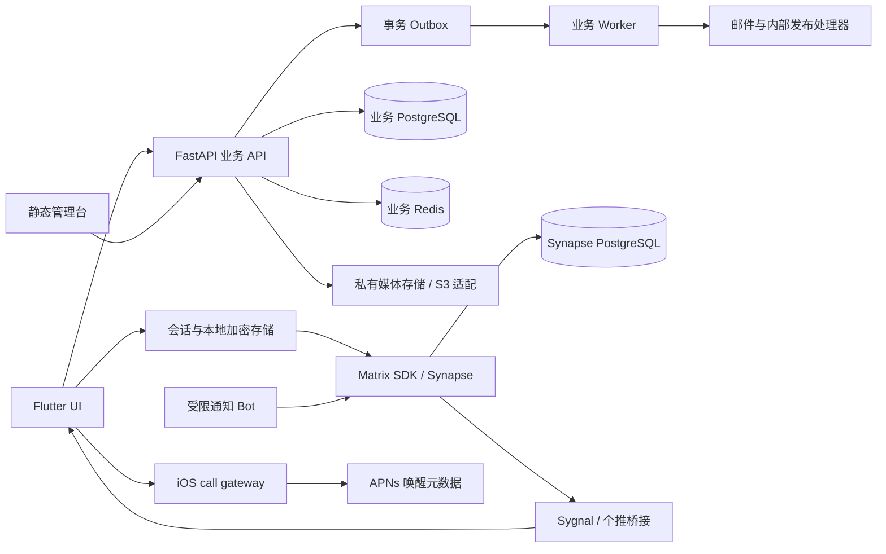

# StarChat / 畅聊项目梳理报告

状态：Reference，2026-10-22（UTC+08:00）本地源码快照；不是生产验收报告。

关联：[Agent 维护指南](../runbooks/agent-maintenance.md) · [执行计划](../superpowers/plans/2026-10-22-project-maintenance.md) · [第一轮验证](../verification/2026-10-22-project-maintenance.md) · [实际 CodeGraph 补充](2026-10-22-codegraph-supplement.md)。

更新说明：下文保留第一轮静态调查的来源和当时结果。用户随后明确授权建索引、隔离环境复核与归档清理；实际图分析已另立报告，不能将本文原有静态链条全部视为图证据。后续状态见[第二轮验证](../verification/2026-10-22-project-maintenance-followup.md)。

## 1. 第一轮范围、来源与 CodeGraph 限制

- 工作目录：`D:/pythonProject/outsource/StarChat`。
- 当前分支/提交：`main` / `5c83a08a09b985146bc507a1608cb2153d361e48`；fetch 后 `origin/main` 为 `be207f0fece77f0a4585790d7c0932368ac63146`，本地领先 36、落后 0。
- 初始工作区有 3 个已跟踪修改和多项未跟踪文档。本文描述这个工作区，不把其他分支内容当成 main 已有实现。
- `codegraph --version` 实测返回 **1.6.0**。第一轮根目录只有 [codegraph.json](../../codegraph.json)、没有 `.codegraph/`，按用户规则跳过建索引，以下初轮主干来自静态阅读。第二轮经用户明确授权已完成索引：2,602 files / 53,036 nodes / 218,898 edges，complete、pending refs/changes 为 0；实际图查询、动态分派候选和原始输出见[独立补充](2026-10-22-codegraph-supplement.md)。
- 替代方法：`rg --files` 限定应用/服务源码；`rg -n` 定位入口和符号；阅读装配、路由、服务及调用点；用 Python AST 提取声明、导入和跨模块导入边；对照 Compose、CI 和实测命令。避开构建目录、私密配置正文、历史 APK 解包目录。
- [静态清单](../verification/artifacts/2026-10-22/project-maintenance/source-inventory.json)包含路径、符号、行号、源文件 SHA-256 和导入边；本次解析 293 个 Python 文件，统计 512 个客户端 `lib` Dart 文件和 72 个 `frontend/src` JavaScript 文件。统计不含 vendored SDK 的完整源码、独立 gateway 和全部测试，不能当全仓代码总量。
- 静态导入边不等于运行时调用，不证明动态分派、回调、平台通道或 SQL 实际行为。第二轮按装配、事务、发送、启动、Worker、管理台/推送入口完成了实际图查询并绑定 main SHA；图中的接口候选仍不等于运行时 trace，不能把本报告所有静态推导都升级为图证据。

## 2. 项目概览

这是一个多语言单仓：Flutter Android/iOS 客户端、FastAPI 业务 API、Python 后台 Worker、Matrix 通信服务、静态 JavaScript 管理台及官网，加上推送、独立 iOS 通话唤醒和生产运维配置。`StarChat`、`ChatFlow`、`liuhetong` 是同仓内不同历史命名，不应自行批量改名。

Matrix/Synapse 负责端到端加密通信；业务 API 管理身份、关系、客服、账本、红包、充值及钱包权威状态。客户端通过两个域的接口协调体验，不能从聊天卡片、通知或 Bot 回调反向推导财务状态。

根 [README](../../README.md) 仍有 Phase 0 集成骨架及未来 React 管理台的历史描述。实际 `frontend/package.json` 是原生 ES module/Node 测试脚本，没有 React 构建链。移动端 README 的模拟器默认地址也已落后于 `AppConfig` 的实际默认值。本文根据当前代码补充事实，不把过时描述当实现清单。

当前 main 的 `pubspec.yaml`、`AppConfig` 是 **0.4.44+2213**，但已修改的下载页和 [状态索引](../workflow/current-state.md)包含 **2233** 发布记录，iOS 下载页已指向 2215。来源分支、发布工件及文档的版本必须分别核实；本次未访问生产。

## 3. 目录与职责

| 路径 | 职责及主要内容 |
| --- | --- |
| `apps/mobile_flutter/lib/` | Dart 应用入口、会话、缓存、持久发件箱、领域页面及 Matrix 适配 |
| `apps/mobile_flutter/android/`、`ios/` | 原生构建、权限、推送、音视频、平台存储 |
| `apps/mobile_flutter/third_party/` | 跟踪的 Matrix SDK、video_compress 补丁；不能直接替换为上游最新版 |
| `frontend/` | `admin.html` 管理入口、官网、下载页、设计 demo；`src/` 组件和 API 客户端，`tests/` Node 测试 |
| `services/business-api/app/` | `api/` 路由、`modules/` 领域逻辑、`core/` 数据库/鉴权/Outbox、`integrations/` 外部适配 |
| `services/business-api/migrations/` | Alembic 数据库迁移；本次 heads 为 `0095_wallet_source_alerts` 单 head |
| `services/business-worker/app/` | Outbox 消费、重试与维护任务，复用安装的 business-api 包 |
| `services/matrix-bot/` | 限定通知房间的 webhook/Bot，独立 SQLite 幂等存储 |
| `services/getui-bridge/` | Matrix push 到个推的净化、速率限制及发送适配 |
| `services/ios-call-gateway/` | 独立 `gateway.py`/Compose，通话唤醒元数据、设备路由和 APNs |
| `packages/api-contracts/` | OpenAPI 文档 `openapi/liuhetong-v1.yaml` |
| `packages/event-schemas/`、`ui-contracts/` | 事件/schema 与 Flutter/HTML UI 契约 |
| `infra/` | Synapse、Element、Nginx、推送、TURN、Compose overlay 和交付基础设施 |
| `third_party/synapse/` | Synapse 定制镜像/补丁，与固定上游版本共同维护 |
| `scripts/`、`tests/`、`.github/workflows/` | 验证、渲染、构建/发布脚本、测试及 Android/iOS CI |
| `docs/` | runbooks 现行流程，specs/plans 规格计划，ADR 决策，verification 证据，workflow 任务状态 |
| `data/`、`.env`、`.worktrees/` | 本机运行资料和工作树；不是应用源码，不作为默认扫描或删除对象 |

## 4. 依赖与数据流

箭头表示主要接口/职责关系，不意味着所有路径同步发生，也不意味着 Worker 自动把所有事件送进 Bot。

### 业务模块

| 模块 | 主要职责、关键文件/符号 | 依赖边界 |
| --- | --- | --- |
| 装配与基础层 | [app/main.py](../../services/business-api/app/main.py) `create_app`、`create_default_app`；[core/config.py](../../services/business-api/app/core/config.py) `Settings` | 显式注入 session factory、限流、Matrix gateway、媒体存储和钱包 runtime |
| identity | 登录、注册、会话、OTP、管理员/客服身份与支付授权；`api/identity.py`、`modules/identity/registration.py` | Synapse 管理适配、Redis；受鉴权/密钥恢复规则约束 |
| friendship / groups / support | 联系人、好友、群与客服关系；对应 `api/`、`modules/` | 业务关系权威在 API，房间成员操作走 Matrix gateway |
| ledger | [ledger/service.py](../../services/business-api/app/modules/ledger/service.py) `LedgerService.post`、`reverse`、`PointTransferService.transfer` | CAIBI 记账、账户锁、储备覆盖、审计、Outbox；不可跨模块直接改账表 |
| transfer / redpacket | `ChatTransferService.create/accept`；`RedPacketService.create_equal/create_random/claim/expire` | 通过 LedgerService 在同一业务事务中处理托管、领取、退款 |
| wallet / recharge / fx | [wallet/runtime.py](../../services/business-api/app/modules/wallet/runtime.py) `create_manual_wallet_runtime`；`RechargeService`；`FxService` | 钱包模式/开关、链观察、人工付款与充值；CAIBI/USDT 精度、兑换和审批单独守门 |
| media / moments | `MediaPlatformService`、`MediaRepository`、`MediaGrantService`、`MomentsMediaBridge` | 私有对象、授权、生命周期、朋友圈受众；业务媒体与加密聊天媒体必须区分 |
| admin / settings / audit | 管理路由、后台操作、设置、审计 | RBAC/TOTP、会话边界及读响应守卫不由前端按钮替代 |
| core/outbox | [outbox.py](../../services/business-api/app/core/outbox.py) `OutboxPublisher.enqueue`、`OutboxConsumer.claim_batch` | 与领域写入共享事务；worker 按处理器表消费，失败按约定重试/死信 |

AST 汇总发现 `identity ↔ wallet`、`ledger ↔ wallet`、`ledger ↔ recharge` 的双向模块导入，`ledger` 还导入 redpacket/transfer 等模块，`media` 导入 moments。部分为局部导入、模型或只读服务，这不能直接认定为循环初始化或跨模块写违规；修改时需检查具体调用/事务边界，不能把目录划分误当完全解耦。

### 客户端关键边界

- [main.dart](../../apps/mobile_flutter/lib/main.dart) `main` / 局部 `startApplication` 组装 `BusinessApiClient`、`MatrixClientFactory`、`MatrixSdkE2eeClient`、`SessionBootstrapController`、`DualDomainLoginService`，最终 `runApp(LiuhetongApp(...))`。
- [session_bootstrap_controller.dart](../../apps/mobile_flutter/lib/core/session_bootstrap_controller.dart) `bootstrap` / `_startBootstrap`：业务会话恢复、本地 Matrix 状态和代次校验；异步完成不能作用到已经切换的账号。
- [business_api_client.dart](../../apps/mobile_flutter/lib/core/business_api_client.dart) `BusinessApiClient.restoreSession`：业务域请求及会话恢复。
- [matrix_e2ee_client.dart](../../apps/mobile_flutter/lib/features/matrix/matrix_e2ee_client.dart) `MatrixE2eeClient` 是接口，`MatrixSdkE2eeClient` 是实现；发送、房间租约、恢复、同步和媒体处理集中于此。
- `lib/core/outbox/` 是客户端持久发件箱；与服务端 `core/outbox.py` 的数据库事务事件完全不同，不得混用幂等与确认语义。

## 5. 关键调用链

以下为阅读代码支持的主干，省略了错误和取消分支；这些分支仍是测试重点。

1. **启动与恢复**：`main → startApplication → openStartupMatrixClient / MatrixClientFactory.create → MatrixSdkE2eeClient + SessionBootstrapController → bootstrap → BusinessApiClient.restoreSession`，然后依照会话状态恢复本地 Matrix/登录流程。启动诊断与本地存储检查应保留失败分类，不能用清空数据库“修复”。
2. **文本消息**：`RoomPage → RoomTimelineController.sendText → 持久 outbox → MatrixRoomTimelineAdapter.sendTextWithTransaction → 房间 capability → Matrix SDK Room.sendTextEvent(txid)`。本地乐观行、事务 ID 和远端事件确认共同收敛；重试不应创建新的逻辑消息。
3. **加密媒体**：`MediaMessageService → MatrixE2eeClient.sendEncryptedMedia → MatrixSdkE2eeClient._sendEncryptedMediaFromLease → SDK 上传/发送`。房间租约与会话身份需要在异步边界持续有效；明文仅在客户端处理。
4. **彩币转账**：`create_transfer_router` 内 `create → ChatTransferService.create → session_factory.begin → LedgerService.post(session=...) → _post → lock_accounts / LedgerTransaction / LedgerEntry / AuditEvent / OutboxPublisher.enqueue`。接受转账沿 `accept` 从托管账户记账给收款人。账本使用 Decimal 与事务检查，客户端只展示 API 结果。
5. **业务异步事件**：`business-worker/app/main.py:main → build_identity_handlers / build_wallet_tasks / build_internal_publication_handlers → Worker.run_forever → OutboxConsumer.claim_batch → 对应 handler → mark_succeeded / mark_failed / mark_dead`。主分支现有代码与未合入的 worker lease/fencing 分支不能混为一谈。
6. **Bot 通知**：`POST /internal/matrix/publish → require_api_key → IdempotencyStore.get → RoomRouter.resolve → MatrixBotClient.send_message → 房间 allowlist → Matrix`，成功结果写入幂等存储。请求不写钱包或账本；不能向普通私聊/群聊开放 Bot。
7. **管理台**：`admin.html → src/admin-home.js → browserAdminApi / createAdminApi → /api/v1 → create_admin_router` 及钱包/客服专用路由。`adminSession` 管理客户端会话；服务端 `create_admin_session_boundary` 与 RBAC/TOTP 仍负责授权。
8. **推送与通话唤醒**：Matrix push 到 `getui-bridge/app/main.py:create_app → sanitize_notification → deliver_sanitized → GetuiRestClient`；独立 iOS gateway 的 `production_app/create_app` 验证 Matrix 身份后处理 APNs 元数据，不接收 SDP、解密音视频或账本写入。

## 6. 配置与依赖

| 配置来源 | 关键项/作用 | 维护注意 |
| --- | --- | --- |
| `.env.example`、Compose | `MATRIX_SERVER_NAME`、内外部 Synapse URL、固定镜像、POSTGRES/REDIS、TURN、邮件、推送 | `.env` 不进 Git，不输出秘密；`--env-file .env.example config --quiet` 只验证示例组合 |
| `core/config.py:Settings` | `BUSINESS_` 前缀，数据库/Redis/JWT/OTP、wallet_*、媒体后端/TTL | `env_file=".env"` 相对启动工作目录，导出契约也可能受本机 `.env` 污染 |
| `lib/core/app_config.dart:AppConfig` | `LIUHETONG_MATRIX_HOMESERVER`、`LIUHETONG_BUSINESS_API_URL`、推送地址、更新及媒体加密开关 | 当前默认地址指向正式域名；本地启动前显式给测试地址，不照搬旧 README 的默认值 |
| `pyproject.toml` + `requirements.lock` | Python `>=3.12,<3.13`；FastAPI/Pydantic/SQLAlchemy/Alembic/psycopg/Redis 等 | 开发依赖有版本范围；生产 Dockerfile 使用 lock、`--no-deps` 安装包并 `pip check` |
| `pubspec.yaml` + `pubspec.lock` | Flutter/Dart、Matrix 本地 fork、WebRTC、SQLCipher、推送及媒体插件 | CI Flutter 3.44.9；本机同版本实测；不要绕过本地补丁 |
| `frontend/package.json` | 原生 Node scripts，无 `build` 或 `lint` script | `test` 不包含浏览器；`verify` 还会运行 browser smoke 和截图 |
| Android Gradle / iOS CI | 原生工程、签名及平台构建 | `android/local.properties` 是机器本地生成输入，里面的旧 version 值不是发布权威 |

## 7. 启动、构建、测试入口

命令完整上下文和实测状态见 [维护指南](../runbooks/agent-maintenance.md)。以下路径均真实存在，表内保留第一轮结果；独立环境完整门禁及后续补查的最新结果见[第二轮验证](../verification/2026-10-22-project-maintenance-followup.md)。

| 用途 | 入口 | 本次结果 |
| --- | --- | --- |
| 综合验证 | `pwsh -NoProfile -File scripts/verify.ps1` | 失败：业务测试收集 12 个错误；此前 infra 905 pass/20 skip、Getui 38 pass、Bot 9 pass |
| 配置渲染/启动 | `scripts/init_matrix.ps1 -RenderOnly` / `-StartAll` | RenderOnly 在综合验证中通过；启动容器未执行 |
| 业务 API | `py -3.12 -m uvicorn app.main:create_default_app --factory`，工作目录 `services/business-api` | 模块 import 通过；服务启动/数据库连接未验证 |
| Worker | `services/business-worker/Dockerfile`，容器内 `python main.py` | 未启动，避免消费事件或运行维护任务 |
| 前端 | `npm --prefix frontend run serve` / `npm --prefix frontend test` | 测试 556 pass/7 fail；静态服务入口已读，启动待测 |
| Flutter lint | 在 `apps/mobile_flutter` 运行 `flutter analyze --no-pub` | 退出 0，无问题；本机需使用已发现的 SDK 绝对路径或补 PATH |
| Flutter 测试/构建 | `flutter test` / `flutter build apk --debug` | 本次未执行；Android 正式交付必须继续 APK 重建和固定签名流程 |
| UI 契约 | `py -3.12 scripts/verify_ui_contract.py` | 34 components / 535 screens，退出 0 |
| OpenAPI | `py -3.12 scripts/export_openapi.py --check` | 退出 1：本地短信有效期为 5，当前校验要求 15 分钟 |
| 迁移 | 在业务 API 目录 `py -3.12 -m alembic heads` | 单 head `0095_wallet_source_alerts`；未对数据库执行 upgrade |
| CI | `.github/workflows/android-ci.yml`、`android-release.yml` 及 `ios-*.yml` | 读取配置，不代表本次 CI 或 iOS 真机通过 |

## 8. 第一轮风险与维护注意（第二轮进展见第 10 节）

1. **来源混杂**：main 落后于部分正在交付的功能分支，下载页却已更新。不能按日期排序后把所有分支盲目合入；先确定候选来源、已有 cherry-pick 和待验收内容。
2. **大型客户端中心文件**：`matrix_e2ee_client.dart` 9764 行、`room_page.dart` 6523 行、`app_home.dart` 3930 行、`business_api_client.dart` 3083 行。账号代次、房间租约、缓存、异步重试和 UI 生命周期耦合，修改一条发送路径必须覆盖取消、切号、恢复与重试。
3. **财务跨域耦合**：ledger/wallet/recharge/identity 互相依赖，必须走公共应用接口，保持 Decimal、按资产平衡、幂等、审计和事务 Outbox。CAIBI 两位、USDT 六位；1:1 双向兑换以根规则为准，不加入 USDT P2P 或红包。
4. **通信保密边界**：密钥、聊天明文及解密媒体不能流入业务日志、推送、gateway 或 Bot；朋友圈业务媒体不是私聊解密媒体的上传通道。
5. **环境污染已经复现**：`py -3.12` 导入的 `tests` 来自 `D:/pentest_ws/strix/tests/__init__.py`，而 `app` 来自本项目。仅设置 PYTHONPATH 未能解决。`python` 实测为 3.11.11，`py -3.12` 为 3.12.10，verify 同时使用二者。应在隔离依赖环境复核，不能全局卸载别的项目包。
6. **配置和契约漂移**：OpenAPI 导出被本地 `.env` 的旧短信参数阻断；本次未证明 OpenAPI 无漂移。不要通过关闭校验获得假通过。
7. **文档/测试时效性**：前端 7 项失败涉及 Android 2213、iOS 2213/2205 等旧断言与现有 2233/2215 页面。需要对照最终批准发布来源决定测试与页面关系，不自动回退发布信息。
8. **部署具有写副作用**：API Docker 启动包含 `alembic upgrade head`；Worker 启动可消费 Outbox；`init_matrix` 会写 `data/`。只读调查不能随意启动生产服务。
9. **平台与证据差异**：Windows 不覆盖 Linux 文件权限/锁、iOS Xcode/签名/真机，Python AST 不等于 lint 或类型检查。Flutter analyze 通过不能替代完整测试和构建。
10. **worktree 数据留存**：39 个 C 盘 worktree 中 30 个有 Git 门禁问题，其余 9 个仍含忽略的验证证据，部分带 `.env/data`。本次删除 0；CIM 未匹配进程不等于文件句柄无占用。D 盘条目完全不属于清理范围。

## 9. 第一轮建议与后续落实

以下建议已由用户在第二轮明确要求执行；索引、归属、环境及清理的最新结果分别见[图分析补充](2026-10-22-codegraph-supplement.md)和[第二轮验证](../verification/2026-10-22-project-maintenance-followup.md)，不以本节代替完成证据。

1. 先处理主工作区既有改动的归属并明确本次应合入的来源分支，保留发布状态与工件身份。
2. 在独立 Python 3.12 环境复现导入及配置问题，确认依赖锁、完整门禁和候选分支测试，再讨论合并；本轮不修业务代码。
3. 对 9 个 Git 条件通过的 worktree，先核对/归档忽略证据、配置和数据，再验证进程/句柄占用；重新检查状态后才考虑 `git worktree remove`。
4. 如需要真正的 CodeGraph 动态调用补充，先决定并完成索引，再按本报告的入口/风险点查询；不以本报告冒充图分析结果。

## 10. 第二轮新增发现

实际复核证据见[第二轮验证](../verification/2026-10-22-project-maintenance-followup.md)，下列发现不修改此前源码身份：

- 已完成 main 的真实 CodeGraph 索引和查询，接口分派/事务链/工具歧义单独记录在[图分析补充](2026-10-22-codegraph-supplement.md)。候选分支不是本次索引输入。
- 候选明确为 `codex/interactive-cache-startup-20261016@8535e07f`，比 main 多 239 个提交；其中 API/Worker 及相关测试有 27 个文件差异，不能只按移动端发布分支审查。
- 独立 Python 3.12 排除了外部 `tests` 包污染，但受跟踪的 worker 兼容测试仍依赖缺失的忽略证据脚本；干净 checkout 的测试可复现性存在缺口。
- 候选 Dart 性能诊断新增 11 个 stage wire 值，服务端允许集合未同步，契约测试稳定失败。不能只以 Flutter analyze 或发布 APK 成功推断双端契约一致。
- 原始依赖锁在 Linux Python3.12 安装/import/pip check 通过；Windows 的 uvloop 平台限制须有明确平台策略，不能误判为同一个导入故障。
- 本机 Git 2.51 移除 worktree 会沿目录 junction 处理目标内容，已通过自建沙盒证实。九项实际清理先保全 555,418 个文件和链接信息、再安全解除 623 个链接，非强制 Git 移除全部成功；其余工作树保留。
- 移动 Python 边界测试会启动本地 PostgreSQL，且现有 Docker CLI 调用缺少超时；本轮遇到 daemon 无响应、清理/探测阻塞。隐私静态检查还会遍历 `docs` 等目录下的忽略历史文件，运行成本与本机证据量相关。这些是验证流程的维护点，不在本轮改测试或工具代码。
