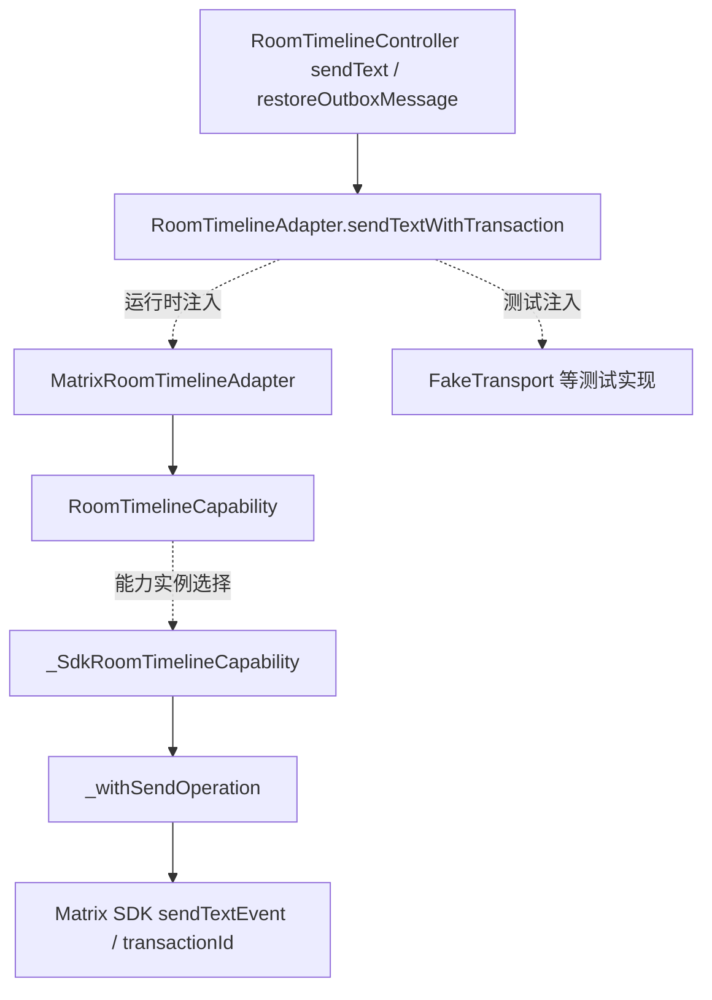

# 合并后的 CodeGraph 项目梳理

状态：Reference，2026-10-23。分析对象为主工作树 `D:/pythonProject/outsource/StarChat`，代码提交 `b729766fbfec6cfcaf977832f16a3ec7aad7ccd6`。本文来自本轮实际 CodeGraph 查询；[初轮静态报告](2026-10-22-project-map.md)和[旧主树图报告](2026-10-22-codegraph-supplement.md)保留其原有时间与来源。

## 项目概览与目录职责

StarChat/畅聊是 Flutter 客户端、Matrix 加密通信域、FastAPI 业务 API、Python Worker、JavaScript 管理台/官网组成的单仓。当前合入的客户端源码为 0.4.64+2233；已发布 Android 2233 与签名 iOS 2215 的身份分别保留，源码版本和已签名工件版本不能混用。

| 路径 | 职责与入口 |
| --- | --- |
| `apps/mobile_flutter/lib/main.dart`、`core/`、`features/` | App 装配、会话、启动投影、发件箱、聊天与业务界面 |
| `apps/mobile_flutter/android/`、`ios/`、`third_party/` | 平台实现及受跟踪 Matrix/媒体 SDK 补丁 |
| `services/business-api/app/main.py`、`api/`、`modules/`、`core/` | API 装配、路由、领域服务、鉴权/数据库/事务 Outbox |
| `services/business-worker/app/main.py`、`worker.py`、`tasks/` | topic 处理器装配、事件 claim/续租、重试和维护任务 |
| `services/matrix-bot/`、`getui-bridge/`、`ios-call-gateway/` | 通知 Bot、净化推送、独立 iOS 呼叫唤醒 |
| `frontend/src/`、`frontend/downloads/` | 管理台 API/会话和页面；发布元数据与下载入口 |
| `packages/`、`infra/`、`scripts/`、`tests/` | OpenAPI/事件/UI 契约、部署配置、构建验证与测试 |
| `docs/` | runbooks 现行流程、reports 参考、verification 证据、workflow 任务记录 |

Matrix 负责加密消息与媒体，业务 API 是身份、客服、账本、红包、钱包的权威。API/Worker 共用业务包，Worker 同时通过注册表装配外部适配器。管理台经业务 API 执行命令；推送和聊天卡片不能反向确定金融状态。

## 索引身份与实际查询

合并前索引为 2,602 files / 53,036 nodes / 218,898 edges。合并后执行 `codegraph sync` 返回 Already up to date；随后状态显示索引已经刷新到以下快照，不能把这条 CLI 输出误读为仍使用旧图。

| 项目 | 本轮实测 |
| --- | --- |
| CodeGraph / extraction | 1.6.0 / 25，node-sqlite |
| 索引时间 | 2026-10-23 06:55:38.249 UTC+08:00 |
| 规模 | 2,731 files / 56,393 nodes / 234,850 edges，数据库 279,244,800 bytes |
| 完成条件 | complete；pendingRefs=0；added/modified/removed 均 0；worktreeMismatch=null |
| 查询 | 10 次实际 MCP explore，均保留原始输出与哈希清单 |

证据：[状态](../verification/artifacts/2026-10-23/project-maintenance-completion/codegraph-status.json)、[同步记录](../verification/artifacts/2026-10-23/project-maintenance-completion/codegraph-sync-result.json)、[查询身份清单](../verification/artifacts/2026-10-23/project-maintenance-completion/codegraph-query-manifest.json)。继续使用原索引范围：排除运行数据、凭据、历史验证/归档、工作树及构建目录；没有升级工具或把数据库纳入 Git。

| 入口/风险 | 查询符号与实测关系 | 原始结果 |
| --- | --- | --- |
| API 装配 | `create_default_app:293 → create_app:46 → create_manual_wallet_runtime:52`；runtime 同时被 API/Worker 使用 | [entry](../verification/artifacts/2026-10-23/project-maintenance-completion/codegraph-entry.md) |
| 账本/Outbox | `transfer/service.py:create:26 → ledger/service.py:post:67 → _post:71 → core/outbox.py:enqueue:51` | [ledger](../verification/artifacts/2026-10-23/project-maintenance-completion/codegraph-ledger.md) |
| 发送动态分派 | `RoomTimelineAdapter.sendTextWithTransaction` 有 11 个实现候选，包含测试 fake；真实目标依注入实例决定 | [dispatch](../verification/artifacts/2026-10-23/project-maintenance-completion/codegraph-dispatch.md)、[目标续查](../verification/artifacts/2026-10-23/project-maintenance-completion/codegraph-dispatch-target.md) |
| 启动投影 | `StartupProjectionCoordinator:32`、`beginCapture:70`、`commit:123`、`runMutation:109`；关联 Matrix 客户端装配和生命周期/撤销测试 | [startup](../verification/artifacts/2026-10-23/project-maintenance-completion/codegraph-startup.md) |
| Worker 续租 | `Worker.run_once:233 → claim_batch/renew_claim/handler`；`create_renewal_engine:7` 被 main 装配及真实 PG 测试引用 | [worker](../verification/artifacts/2026-10-23/project-maintenance-completion/codegraph-worker.md) |
| topic 注册 | `main → build_internal_publication_handlers:42`；源码把内部 topic 集合映射到 `InternalPublicationTask`，身份处理器另按配置装配 | [registry](../verification/artifacts/2026-10-23/project-maintenance-completion/codegraph-worker-registry.md) |
| 管理台/推送 | `browserAdminApi:208 → createAdminApi:31 → request/command`；`deliver_sanitized:190` 关联 bridge 测试 | [frontend](../verification/artifacts/2026-10-23/project-maintenance-completion/codegraph-frontend.md) |
| 诊断契约 | 精确文件查询确认 `PerformanceStageWire:132` 为静态 Literal；模型保留 strict/extra forbid 等验证。11 个新增值的完整一致性另由 Dart/API 测试和 OpenAPI 检查确认 | [初查](../verification/artifacts/2026-10-23/project-maintenance-completion/codegraph-diagnostics.md)、[文件续查](../verification/artifacts/2026-10-23/project-maintenance-completion/codegraph-diagnostic-contract.md) |

## 动态调用、数据流与维护边界

以下发送链结合图返回的接口实现关系和目标源码，不是本轮采集的线上运行时 trace：

目标源码 `matrix_room_timeline_adapter.dart:285` 将调用转发给 `_capability.sendTextWithTransaction`；`matrix_e2ee_client.dart:4390` 的 SDK capability 在 `_withSendOperation` 内传入 transaction ID，并关闭命令解析。不能把图中的 11 个候选写成 11 个线上适配器，也不能越过 lease/会话撤销约束直接使用 SDK room。

启动投影只承载有界显示数据。Coordinator 的 permit 同时绑定 owner 和 revision；`beginMutation` 先失效 head，`commit` 写前/写后检查当前性。显示 permit 与可提交 permit 是不同类型。串行器只保护 head 写入，不能跨网络、加密、捕获或 SDK 事务持锁。这是切号、撤销和并发刷新时最重要的耦合边界。

Worker 图显示 `run_once → handler`，具体 topic 目标仍取决于注册表、消息和配置，不能把泛用 `handler/get/run_once` 名称拼成完整生产链。续租使用独立连接池：pool_size=1、max_overflow=0、pool_timeout=1；连接上限 3 秒、statement/idle-in-transaction 5 秒、lock 1 秒，并保留 URL 的 TLS/路由选项。已有 14 项真实 PostgreSQL claim/fencing/续租测试分别在独立 18.3 与固定镜像 16.9 通过。

账本链应保持按资产平衡、幂等、审计与同一事务 Outbox；消费通知不成为金融权威。管理台命令若丢失响应，不能盲目重复提交；当前 `createAdminApi` 源码明确把结果未知的网络错误交给状态恢复流程。前端权限显示不代替服务端授权。

## 配置、启动、构建与验证入口

- API 的 `Settings` 与 CWD 下 `.env`、各服务同名 `app` 包构成环境耦合；隔离解释器并分别核对 PYTHONPATH、`app.__file__`、`tests.__path__`。本机主树短信有效期配置与校验要求不一致，门禁仅以进程变量设置 15 分钟，未改用户配置。
- 数据库/缓存和身份、TOTP、托管提供方配置由环境管理，不进入文档正文。Worker 的独立 PG 门禁需任务专用 `IM_WORKER_LEASE_TEST_DATABASE_URL`；其他 PG 变量不能自动指向生产或复用他人数据库。
- 移动 `AppConfig`、会话安全存储、启动投影 admission、Matrix/媒体 fork 是跨模块修改时的检查入口。发布参数、下载 registry、APK/IPA 及签名身份分别核验。
- 生产 Python 锁在 Linux 3.12 原样安装通过；Windows 临时派生环境只去除不支持的平台包 uvloop，未修改锁。此结果不等于已经提供正式 Windows 锁策略。

| 入口 | 命令与状态 |
| --- | --- |
| 综合门禁 | `pwsh -NoProfile -File scripts/verify.ps1`；独立 Python 3.12 包装下退出 0；AST 管道另直连验证 288 文件 |
| API 启动 | 在 `services/business-api` 执行 `py -3.12 -m uvicorn app.main:create_default_app --factory --host 127.0.0.1 --port 8082`；TODO：本轮未启动服务 |
| 本地配置 | `pwsh -NoProfile -File scripts/init_matrix.ps1 -RenderOnly`、`docker compose --env-file .env.example config --quiet` 通过 |
| 前端 | `npm --prefix frontend test`，570 passed；`npm --prefix frontend run serve` 是开发入口，TODO：未新增浏览器验收；没有通用 build/lint script |
| Flutter | 3.44.9；本任务 analyze 已通过，6,378 pass / 9 skip 为相同输入历史证据；新包构建遵循 APK runbook，iOS 原生构建需 macOS |
| 契约/迁移 | `scripts/export_openapi.py --check`、`scripts/verify_ui_contract.py`、Alembic 单 head/offline SQL 通过；未运行生产迁移 |

完整可复制命令、代码/Git 工作流、调试、FAQ 与检查清单见[Agent 维护指南](../runbooks/agent-maintenance.md)；精确结果、限制和清理清单见[完成报告](../verification/2026-10-23-project-maintenance-completion.md)。

## 图分析局限与后续注意事项

- 实际查询按文件/符号执行，输出有文件数、字符数和源码窗口上限；并非整仓所有边均经人工验证。泛用符号会混入其他模块，影响范围统计包含测试和同名候选。
- 图对 `build_internal_publication_handlers` 报告三跳内未找到测试，但同一查询列出了 Worker 的 internal publication 测试；不能据此声称不存在测试。
- 首次诊断查询混入 Matrix 的 `client` 同名成员，已用精确文件续查；类型别名和 Literal 值不能仅靠调用图证明完整契约。
- 索引语言不包含 PowerShell。根验证脚本、stdin 转发及命令真实结果须独立验证，不能从图推断执行成功。
- 148 项标准门禁条件跳过和依赖弃用警告均保留，详见完成报告；图不能替代专用数据库、macOS/Ruby、真机或生产验收。本轮没有发送真实消息、采集聊天内容或接触生产服务。
